<p align="center">
  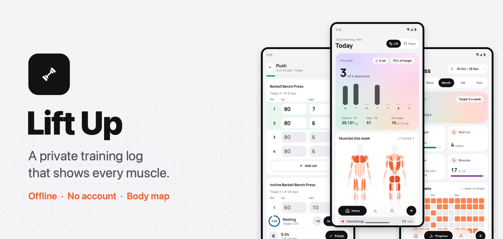
</p>

<h1 align="center">Lift Up</h1>

<p align="center">
  <b>Train well. See it clearly.</b><br>
  An offline Android workout logger. Build plans, log sets, and see which muscles you are
  actually training.<br>
  A body map, streaks and records. No account, no ads, no tracking.
</p>

<p align="center">
  <a href="#install">Install</a> ·
  <a href="#what-it-does">Features</a> ·
  <a href="#build">Build</a> ·
  <a href="docs/ui-house-rules.md">Design system</a>
</p>

<p align="center">
  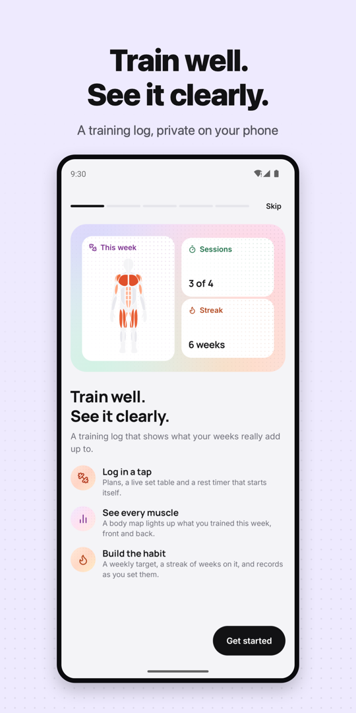
  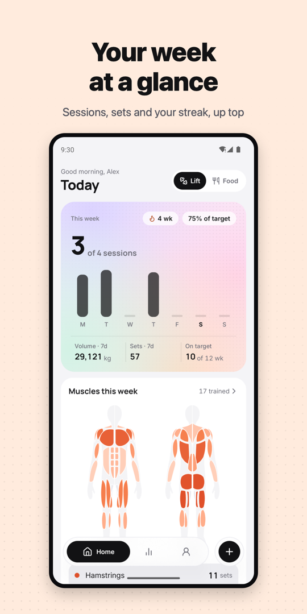
  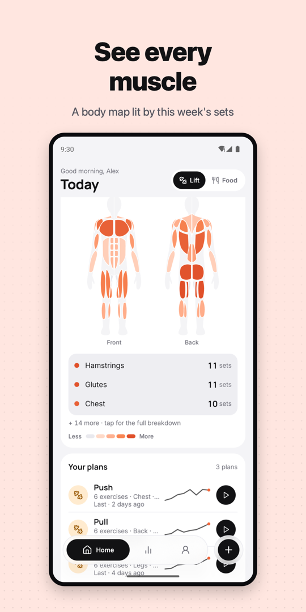
  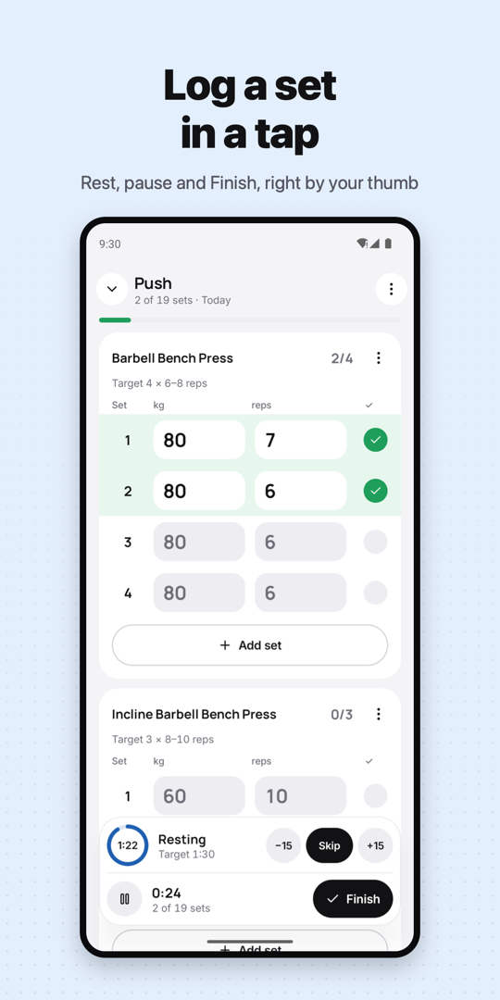
</p>
<p align="center">
  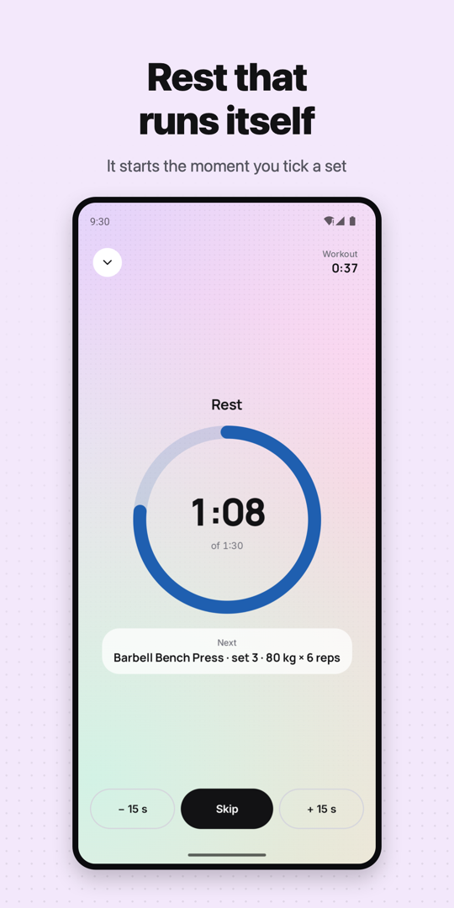
  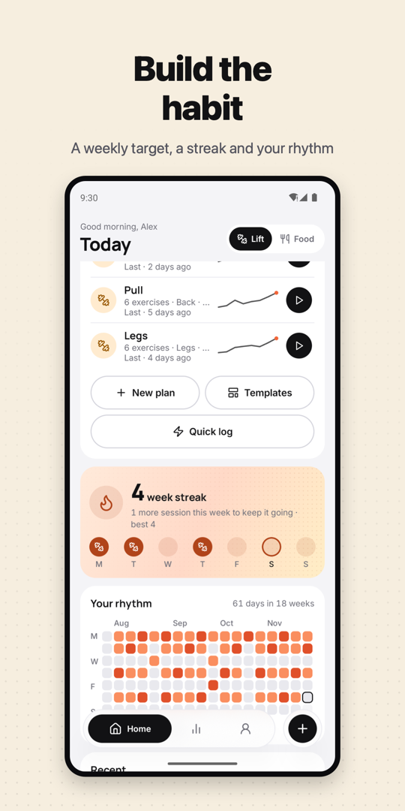
  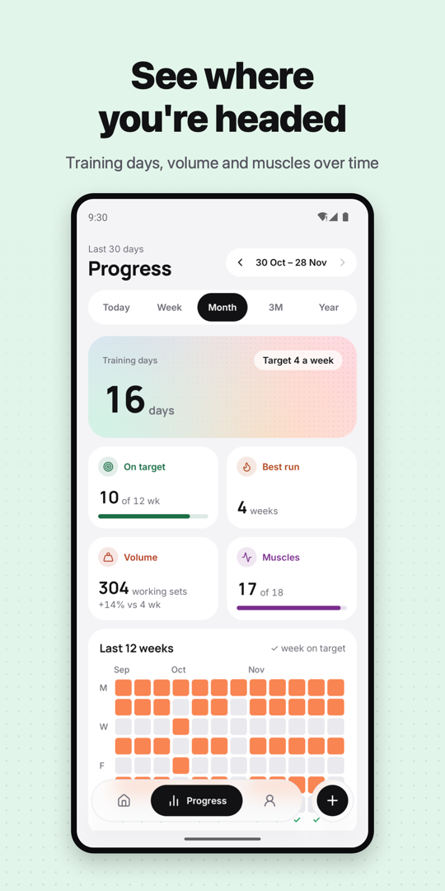
  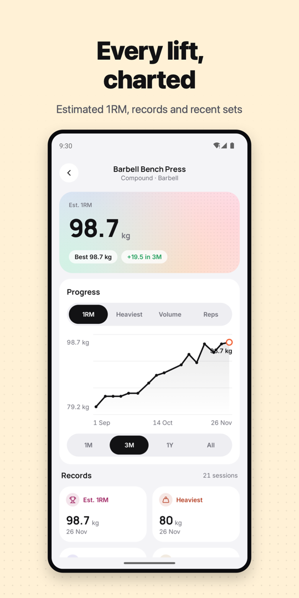
</p>
<p align="center">
  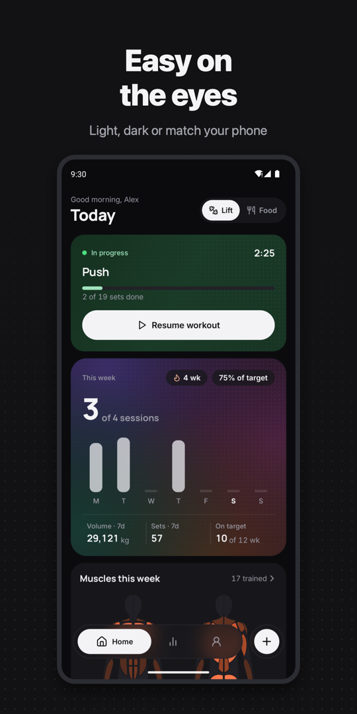
  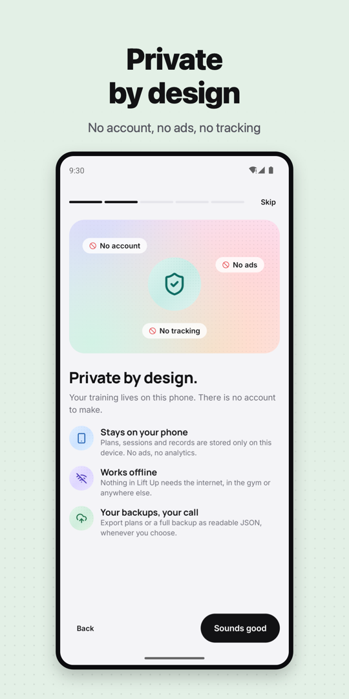
  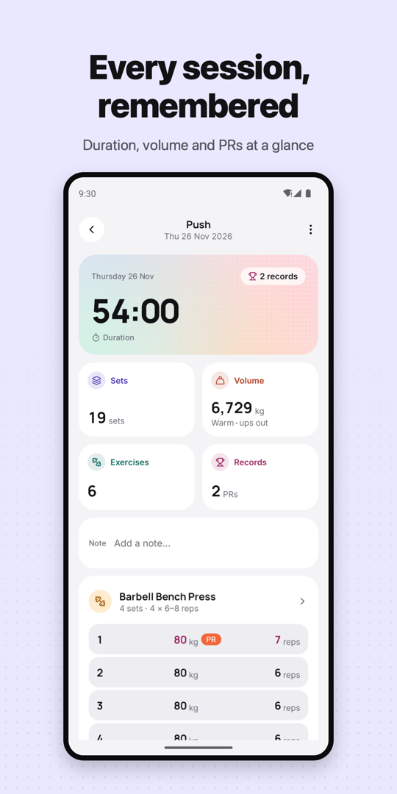
  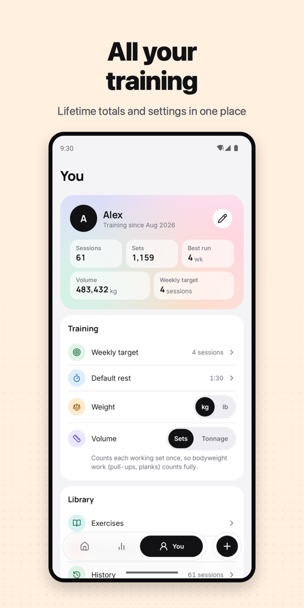
</p>

Lift Up is the training half of a pair: it shares its design system with
[Foodprint](../food-tracker), the food diary, and a **Lift | Food** switch on Home jumps
between the two.

Your data never leaves the phone. There is no account, no analytics and no ads, and the app
does not request the internet permission at all — it cannot make a network call.

## What it does

- **Home at a glance:** the week against your target and sets per day, a **body map** (front
  and back, hands and feet) lit by this week's volume per muscle, your plans with a one-tap
  Start, a streak of weeks on target, an 18-week rhythm heatmap, and the last few sessions.
  The round **+** beside the tab bar starts a workout from anywhere.
- **A short first run:** what the app does, how it treats your data, then your name and
  units, your weekly target and rest, and an optional ready-made split to start from.
- **Plans** with target sets and a rep range per exercise, built in the editor or imported
  from JSON. Export them the same way to share or move them.
- **Session logger:** reps and weight per set, with last session's numbers alongside as a
  hint. Mark sets as warm-up, working or failure. A dock at the bottom holds everything
  else within a thumb's reach: the rest ring with −15 / +15 and Skip, Pause, and Finish or
  Discard, confirmed in place. Tap the ring for a full-screen rest timer with the next set.
  - A **rest timer** that alerts you when rest is up, even with the app in the background;
    an ongoing notification keeps the session alive while the phone is in your pocket.
  - **Personal records** flagged live as you log: estimated 1RM, heaviest weight, best set
    volume, and max reps for bodyweight work.
- **Progression hints** using double progression: once every working set has hit the top of
  its rep range without grinding to failure, the app tells you it is time to add weight.
- **Exercise library:** 176 built-in exercises (75 compound, 85 isolation, 9 mobility,
  7 cardio), each tagged with primary and secondary muscles across 18 regions. Add your own.
- **Progress:** the body map shaded by training volume per muscle, counted in sets or
  tonnage, over any week, month or year; per-exercise progress charts; and a training
  calendar.
- **A weekly target** instead of a daily streak — "3 of 4 this week" — so a rest day is not
  a broken chain.
- **kg or lb**, switchable at any time; weights are stored in kg and converted for display.
- **Backup and restore** of everything, or just your plans, to a file you choose.
- **Light, dark or match system**, light by default.

## Install

Grab the APK from [Releases](../../releases). It is signed with the public key committed in
this repo, so each release installs over the last as an update.

That key is public on purpose, which means anyone can sign an APK with it — it is a
convenience for updating, never proof of who built a build.

## Build

```sh
./gradlew assembleDebug        # APK at app/build/outputs/apk/debug/
./gradlew installDebug         # build + install on a connected device
./gradlew assembleRelease      # signed, R8-shrunk release APK
./gradlew testDebugUnitTest    # unit tests
```

Android SDK 37 and a Java 21 toolchain. The Gradle daemon pins Java 21 in
`gradle/gradle-daemon-jvm.properties` and downloads it if you do not have it, so the wrapper
is all you need. `minSdk` is 31 (Android 12).

CI mirrors this: **Actions → Build Release APK** builds any branch and attaches the APK to
the run, and **Actions → Trigger a Release** bumps the version, builds, then tags and
publishes a release only if the build passed.

## Stack

Kotlin · Jetpack Compose (Material 3, light and dark) · Room · DataStore ·
kotlinx.serialization · Lucide icons · Haze (frosted tab bar) · Manrope and Inter as
downloadable Google Fonts (fetched by Play Services, so the app still needs no internet
permission)

Single module, MVVM:
- `data/`: the Room database, the seeded exercise library, preferences, backup and plan
  import/export.
- `domain/`: the training logic — records, progression, per-muscle volume, the weekly target.
- `session/`: the foreground service and notification that carry a session in the background.
- `ui/`: shared components in `components/`, one package per screen under `screens/`.

The look follows Foodprint's design system, written up in
[docs/ui-house-rules.md](docs/ui-house-rules.md): cards on a calm canvas, ink actions, soft
pastel gradients behind the one number a screen is about. Home is the reference screen.

## How it was made

Built with AI assistance (Claude), directed, designed and tested by its maintainer. The commit
trailers say so too.

## License

[MIT](LICENSE) © 2026 Gym Tracker contributors.
